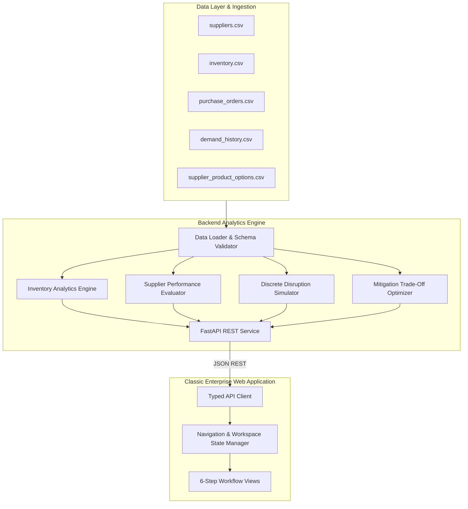

# SupplyShield AI

### Supply Chain Risk Intelligence & Decision Support Platform

SupplyShield AI is an enterprise supply chain risk intelligence and scenario simulation platform. It enables operations managers, procurement directors, and inventory planners to identify upstream supply chain vulnerabilities, simulate catastrophic vendor disruptions, and quantitatively evaluate mitigation strategies before stockouts impact revenue.

---

## 1. Executive Summary

Supply chains operate under increasing volatility from vendor delays, port congestion, and geopolitical friction. Organizations often lack the quantitative tools to assess stockout risks in advance, leaving teams to react after warehouse shelves are already empty.

SupplyShield AI bridges the gap between raw ERP transactional records and strategic decision-making:
* **Predictive Stockout Detection:** Identifies products whose warehouse stock will deplete before inbound supplier replenishment arrives.
* **Supplier Vulnerability Indexing:** Evaluates vendor reliability using a multi-factor composite risk formula (0 to 100 scale) based on actual purchase order execution history.
* **Deterministic Disruption Simulation:** Models day-by-day inventory trajectories during factory shutdowns, transport bottlenecks, and demand surges.
* **Mitigation Cost-Benefit Optimizer:** Compares emergency air freight, pre-qualified backup suppliers, and regional depot buffer transfers against the financial exposure of unfulfilled customer orders.

---

## 2. System Architecture



### Technology Stack
* **Backend:** Python 3.12, FastAPI, Pandas, NumPy, Pydantic v2, Uvicorn, Pytest.
* **Frontend:** React 19, TypeScript, Tailwind CSS, Vite, Lucide Vector Icons.
* **Architecture:** Decoupled client-server architecture with RESTful APIs, typed data contracts, and dual-mode resilient API fallback.

---

## 3. The 6-Step Workflow

SupplyShield AI is structured around a natural, progressive operational workflow:

```
[1. Data & Import] -> [2. Overview] -> [3. Inventory] -> [4. Suppliers] -> [5. Disruption Simulator] -> [6. Mitigation Planner]
```

### Step 1: Data & Import
* **Clean Initial State:** Starts as an unpopulated workspace, allowing teams to test custom datasets or load reference industry data.
* **Interactive CSV Ingestion:** Drag-and-drop file upload for suppliers, inventory, purchase orders, demand logs, and sourcing options.
* **Data Quality Auditor:** Automatically inspects schema conformity, null fields, primary key uniqueness, and foreign-key referential integrity across all files.

### Step 2: Overview (Operations Cockpit)
* **Status Action Banner:** Instant operational status highlighting how many products require urgent procurement intervention.
* **Key Performance Indicators:**
  * Total Warehouse Inventory Valuation.
  * Stockout Risk Exposure (projected lost sales revenue).
  * Products in Critical or High Risk status.
  * Overdue Purchase Orders from active vendors.
* **Priority Queues:** Instant rankings of products running out earliest and suppliers generating the highest delay risk.

### Step 3: Inventory Management
* **Stock Coverage Metrics:** Real-time calculation of daily sales velocity, days of cover, and safety buffer thresholds.
* **Lead-Time Shortfall Gap:** Identifies whether current stock can cover the vendor's required manufacturing and shipping window.
* **Product Detail Drawer:** Detailed SKU analysis, including 90-day demand history trends, days-of-cover run-rate, and suggested replenishment actions.
* **Export Capability:** Filter catalog by risk status or category and export clean CSV reports.

### Step 4: Supplier Performance
* **Objective Reliability Tracking:** Automatically benchmarks promised lead times against actual purchase order delivery timestamps.
* **Composite Risk Scoring (0 to 100):** Weighted multi-dimensional scoring incorporating on-time delivery rate, average delay severity, defect rate, and inventory concentration.
* **Side-by-Side Vendor Compare:** Compare up to 4 suppliers simultaneously across on-time percentage, standard lead times, and average delay.
* **Purchase Order Audit:** Drill into complete vendor order histories with completed, in-transit, and late shipment classifications.

### Step 5: Disruption Simulator
* **Scenario Parameter Controls:**
  * Target Supplier shutdown selection.
  * Disruption duration slider (7 to 60 days).
  * Customer demand surge multiplier (1.0x to 2.0x).
* **Trajectory Modeling:** Interactive day-by-day balance simulation comparing undisturbed inventory curves against scenario stockout depletion curves.
* **Exposure Quantifier:** Calculates cumulative unmet customer demand and projected lost revenue for every SKU sourced from the affected supplier.

### Step 6: Mitigation Planner
* **Side-by-Side Strategy Evaluation:** Evaluates four distinct operational responses for any vulnerable product:
  1. **Do Nothing (Normal Replenishment):** Zero incremental investment, but incurs full customer stockout exposure.
  2. **Expedite Existing PO (Air Freight):** Compresses transit time by 50% for an expedited shipping premium.
  3. **Secondary Sourcing (Backup Vendor):** Routes demand to pre-qualified alternative domestic or regional suppliers.
  4. **Safety Buffer Transfer (Inter-Depot Reallocation):** Pulls safety reserves from sister distribution centers within 48 to 72 hours.
* **Quantified Decision Metrics:** Shows exact incremental cost, days to delivery, units protected, and revenue protected.
* **Export Action Plan:** Download approved mitigation plans as structured CSV execution briefs for procurement teams.

---

## 4. Mathematical Methodology & Formulas

| Metric | Mathematical Formula | Operational Significance |
| :--- | :--- | :--- |
| **Days of Cover (DOC)** | `Current Stock Units / Average Daily Demand Units` | Quantifies the number of calendar days warehouse inventory will last before total depletion. |
| **Lead-Time Demand (LTD)** | `Average Daily Demand * Standard Lead Time (Days)` | Total inventory volume consumed during the replenishment latency window. |
| **Stockout Shortfall** | `max(0, Lead-Time Demand - Current Stock Units)` | Number of units customer orders will exceed warehouse supply before new shipments arrive. |
| **Financial Exposure (£)** | `Stockout Shortfall Units * Unit Retail Valuation` | Total gross revenue at risk if replenishment is not expedited. |
| **Actual On-Time Rate (%)** | `(Completed Orders Arrived <= Expected Date / Total Completed Orders) * 100` | Empirical delivery reliability calculated from historical purchase order transactions. |

### Supplier Risk Index (0 to 100 Scale)
A weighted composite index where higher scores represent higher operational risk:

$$\text{Supplier Risk Score} = \sum_{i=1}^{5} (w_i \times R_i)$$

* **On-Time Delivery Risk (35%):** `100 - Actual On-Time Delivery Rate (%)`
* **Delay Severity Risk (20%):** `min(100, (Average Delay Days / 8.0) * 100)`
* **Quality Defect Risk (15%):** `min(100, (Defect Rate (%) / 4.0) * 100)`
* **Financial Vulnerability (15%):** Standardized external financial stability metric (0 to 100).
* **Inventory Concentration (15%):** `min(100, Share of Total Inventory Value (%) * 3.5)`

---

## 5. API Reference

The backend provides a RESTful API with automated documentation available at `/docs` (Swagger UI) and `/redoc`.

### Core Endpoints

| Method | Endpoint | Description |
| :--- | :--- | :--- |
| `GET` | `/api/health` | Service health status, cutoff date, and catalog load state. |
| `GET` | `/api/overview` | Executive KPI summaries, risk counts, and urgent queues. |
| `GET` | `/api/inventory` | Filterable inventory catalog with days of cover and exposure. |
| `GET` | `/api/inventory/{product_id}` | Detailed product parameters and recommended actions. |
| `GET` | `/api/inventory/{product_id}/demand-history` | Historical daily sales logs and forecast trends. |
| `GET` | `/api/suppliers` | Full vendor registry with composite risk scores and ratings. |
| `GET` | `/api/suppliers/{supplier_id}` | Vendor purchase orders, lead-time variance, and products. |
| `POST` | `/api/simulation/run` | Executes discrete day-by-day disruption scenario simulation. |
| `POST` | `/api/mitigation/compare` | Evaluates 4 operational mitigation response strategies. |
| `GET` | `/api/data-explorer/quality` | Foreign-key validation, null audits, and dataset samples. |
| `POST` | `/api/data-explorer/load-sample` | Ingests full reference catalog and triggers live calculation. |
| `POST` | `/api/data-explorer/clear` | Clears workspace to initial blank state (0 records). |
| `POST` | `/api/data-explorer/upload` | Ingests custom company CSV files. |

---

## 6. Local Setup & Installation

### System Prerequisites
* **Python:** Version 3.11 or 3.12
* **Node.js:** Version 18.x, 20.x, or 22.x
* **Package Managers:** pip and npm

### 1. Clone the Repository
```bash
git clone https://github.com/your-username/SupplyShield.git
cd SupplyShield
```

### 2. Configure Backend Service
```bash
# Optional: create and activate Python virtual environment
python -m venv .venv

# Windows PowerShell:
.\.venv\Scripts\Activate.ps1

# Linux / macOS:
source .venv/bin/activate

# Install backend dependencies
pip install -r backend/requirements.txt
```

### 3. Configure Frontend Application
```bash
cd frontend
npm install
cd ..
```

### 4. Run the Full Application

#### Option A: Concurrent Unified Start (Recommended)
From the project root:
```bash
npm run dev
```
This automatically boots both the FastAPI backend (`http://127.0.0.1:8000`) and the Vite development server (`http://localhost:5173`).

#### Option B: Independent Terminals

* **Terminal 1 (Backend):**
  ```bash
  python backend/run.py
  ```
  Backend starts on `http://127.0.0.1:8000`.

* **Terminal 2 (Frontend):**
  ```bash
  cd frontend
  npm run dev
  ```
  Frontend starts on `http://localhost:5173`.

---

## 7. Verification & Automated Testing

### Backend Test Suite
The backend test suite verifies all mathematical calculations, risk categorizations, day-by-day simulation trajectories, mitigation cost evaluations, and REST API endpoints:

```bash
python -m pytest backend/tests/ -v
```

All 27 automated tests pass:
```
backend/tests/test_api.py::test_health_endpoint PASSED
backend/tests/test_api.py::test_overview_endpoint PASSED
backend/tests/test_api.py::test_inventory_endpoint PASSED
backend/tests/test_api.py::test_inventory_detail_and_demand_history PASSED
backend/tests/test_api.py::test_suppliers_endpoint PASSED
backend/tests/test_api.py::test_simulation_endpoint PASSED
backend/tests/test_api.py::test_mitigation_endpoint PASSED
backend/tests/test_api.py::test_data_quality_endpoint PASSED
backend/tests/test_api.py::test_methodology_endpoint PASSED
backend/tests/test_inventory.py::test_calculate_days_of_cover_normal PASSED
backend/tests/test_inventory.py::test_calculate_days_of_cover_zero_demand PASSED
backend/tests/test_inventory.py::test_calculate_lead_time_demand PASSED
backend/tests/test_inventory.py::test_calculate_shortfall PASSED
backend/tests/test_inventory.py::test_classify_inventory_risk PASSED
backend/tests/test_inventory.py::test_inventory_service_summary PASSED
backend/tests/test_mitigation.py::test_mitigation_strategies_comparison_with_alt_supplier PASSED
backend/tests/test_mitigation.py::test_mitigation_budget_constraint PASSED
backend/tests/test_mitigation.py::test_mitigation_invalid_product PASSED
backend/tests/test_simulation.py::test_simulation_long_disruption_produces_unmet_demand PASSED
backend/tests/test_simulation.py::test_simulation_short_disruption_safe_product PASSED
backend/tests/test_simulation.py::test_simulation_demand_multiplier_effect PASSED
backend/tests/test_simulation.py::test_simulation_supplier_scope PASSED
backend/tests/test_suppliers.py::test_risk_weights_sum_to_one PASSED
backend/tests/test_suppliers.py::test_on_time_rate_calculation PASSED
backend/tests/test_suppliers.py::test_on_time_rate_insufficient_history PASSED
backend/tests/test_suppliers.py::test_risk_score_directionality PASSED
backend/tests/test_suppliers.py::test_supplier_service_integration PASSED

======================== 27 passed in 1.04s ========================
```

### Frontend Type-Safety and Production Bundle
Verify TypeScript type-checking and asset bundling:

```bash
cd frontend
npm run build
```

Bundle builds with zero TypeScript errors.

---

## 8. Data Schema Specifications

The system operates on five standardized dataset schemas:

1. **`suppliers.csv`**:
   * `supplier_id` (PK, string): Unique identifier (`SUP001`).
   * `supplier_name` (string): Corporate legal entity name.
   * `country` (string): Sourcing geography.
   * `standard_lead_time_days` (integer): Quoted production and delivery cycle.
   * `historical_on_time_rate` (float): Contractual on-time delivery metric.
   * `defect_rate_pct` (float): Percentage of received batches with quality defects.
   * `financial_stability_score` (float): External credit stability rating (0 to 100).

2. **`inventory.csv`**:
   * `product_id` (PK, string): Stock Keeping Unit identifier (`SKU-ELC-001`).
   * `product_name` (string): Commercial product title.
   * `category` (string): Departmental classification.
   * `supplier_id` (FK, string): Primary supplier identifier.
   * `current_stock_units` (integer): Physical on-hand inventory.
   * `safety_stock_units` (integer): Minimum desired buffer stock.
   * `average_daily_demand_units` (float): 90-day moving average sales rate.
   * `unit_cost` (float): Standard procurement purchase cost.
   * `unit_price` (float): Standard customer retail selling price.

3. **`purchase_orders.csv`**:
   * `purchase_order_id` (PK, string): Order tracking identifier.
   * `supplier_id` (FK, string): Target vendor.
   * `product_id` (FK, string): Ordered item.
   * `order_date` (ISO date): Date PO was transmitted to vendor.
   * `expected_delivery_date` (ISO date): Contractual delivery commitment.
   * `actual_delivery_date` (ISO date, nullable): Timestamp of physical goods receipt.
   * `quantity_ordered` (integer): Batch volume.
   * `status` (string): `Completed`, `In Transit`, or `Pending`.

4. **`demand_history.csv`**:
   * `date` (ISO date): Transactional calendar date.
   * `product_id` (FK, string): Item sold.
   * `units_sold` (integer): Physical quantity fulfilled to end customers.

5. **`supplier_product_options.csv`**:
   * `product_id` (FK, string): Target SKU.
   * `supplier_id` (FK, string): Qualified secondary or alternative vendor.
   * `lead_time_days` (integer): Lead time quoted by alternative vendor.
   * `unit_cost` (float): Purchase cost quoted by alternative vendor.
   * `is_primary` (boolean): Flag indicating primary vs secondary sourcing status.

---

## 9. License

This project is licensed under the MIT License.
